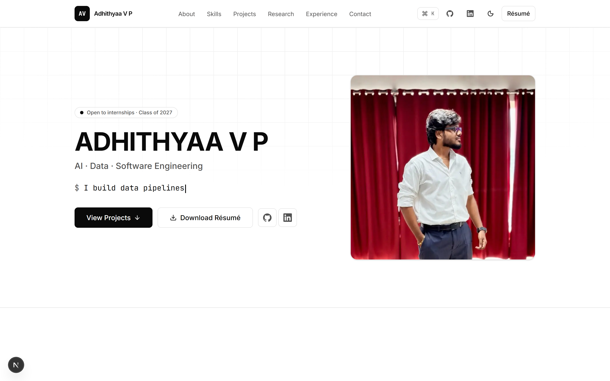
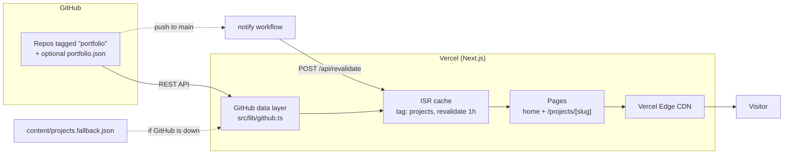

# Adhithyaa V P — Portfolio

An interactive, **self-updating** developer portfolio. Projects are pulled live
from GitHub: any repo tagged with the `portfolio` topic appears automatically,
with no code changes and no redeploy.

**Live:** _(added after the first Vercel deploy)_
**Stack:** Next.js 16 (App Router) · TypeScript · Tailwind CSS v4 · Framer Motion · Vercel

<!-- TODO: add a screenshot at docs/screenshot.png and uncomment -->
<!--  -->

---

## How it stays up to date



1. A repo is shown **only** if it has the `portfolio` topic — you control
   visibility by adding/removing one topic.
2. Each repo can include an optional `portfolio.json` to control its title,
   tagline, category, highlights, metrics, demo link, featured flag and order.
   Everything falls back to the repo's own description, topics, languages and
   `RESUME_BULLETS.md`.
3. Project data is cached with **ISR** (`revalidate = 3600`) and tagged
   `projects`. A push to any project repo calls `POST /api/revalidate` and the
   site updates within seconds (see [docs/auto-update.md](docs/auto-update.md)).
   A daily scheduled workflow is a safety net.
4. If the GitHub API is ever unreachable, the site serves a committed snapshot
   (`content/projects.fallback.json`) so it never breaks.

See [docs/HOW_TO_UPDATE.md](docs/HOW_TO_UPDATE.md) for the day-to-day guide, and
[INTERVIEW_NOTES.md](INTERVIEW_NOTES.md) for an architecture deep-dive.

## Features

- **Live GitHub projects** with category tabs, search and tech-badge filters
- **Interactive skills** — hover a skill to spotlight matching projects, click to filter
- **Project detail pages** rendering each repo's README (GFM, syntax highlighting, Mermaid)
- **⌘K / Ctrl+K command palette** (jump to sections/projects, copy email, theme, resume)
- **Light / dark theme** (class-based, system-aware, no flash)
- **Dynamic OG images**, sitemap, robots, JSON-LD `Person`, generated "AV" icons
- **Contact form** (zod validation, honeypot, rate limit) with Resend + mailto fallback
- Accessible (WCAG 2.2 AA intent): landmarks, skip link, focus rings, reduced-motion
- ISR + on-demand revalidation; fallback snapshot so the page never breaks

## Local development

```bash
npm install
cp .env.example .env.local   # optional; fill in values
npm run dev                  # http://localhost:3000
```

> This repo uses `legacy-peer-deps=true` (`.npmrc`) because some current
> dev-tooling peer ranges don't yet overlap on npm's strict resolver.

### Scripts

| Script | What it does |
| --- | --- |
| `npm run dev` | Start the dev server |
| `npm run build` / `npm run start` | Production build / serve |
| `npm run lint` | ESLint |
| `npm run typecheck` | `tsc --noEmit` |
| `npm test` | Vitest unit tests |
| `npm run test:e2e` | Playwright end-to-end tests |
| `npm run format` | Prettier write |

## Environment variables

Copy `.env.example` → `.env.local`. All are optional for local dev.

| Variable | Purpose |
| --- | --- |
| `GITHUB_TOKEN` | Fine-grained, read-only **public repos** token. Lifts the 60 req/hour unauthenticated GitHub rate limit. Recommended in production. |
| `REVALIDATE_SECRET` | Shared secret for `POST /api/revalidate?secret=…`. |
| `RESEND_API_KEY` | Enables server-sent contact email. If unset, the form falls back to a mailto link. |
| `NEXT_PUBLIC_SITE_URL` | Absolute site URL for metadata/OG/sitemap. Derived automatically on Vercel. |

## Project structure

```
src/
  app/                 App Router: pages, api routes, metadata files (icon, OG, sitemap…)
    projects/[slug]/   Dynamic project detail + per-project OG image
    api/revalidate/    On-demand ISR webhook
    api/contact/       Contact form endpoint (Resend + mailto fallback)
  components/
    sections/          Hero, About, Research, Timeline, Contact
    projects/          Project card, work explorer, markdown + mermaid renderer
    site/              Nav, footer, command palette, theme, scroll utilities
    ui/                Button, Badge primitives
  lib/
    github.ts          Server-only GitHub fetch orchestration (ISR tagged)
    project-mapper.ts  Pure, tested mapping logic (repo + portfolio.json → Project)
    types.ts, site.ts, contact-schema.ts, revalidate.ts, utils.ts
content/
  profile.ts                  Static content (about, skills, research, timeline)
  projects.fallback.json      Committed snapshot used if GitHub is unreachable
```

## Deployment (Vercel)

1. `vercel link` (framework: Next.js).
2. Connect the GitHub repo in the Vercel dashboard so every push to `main`
   auto-deploys to production and every PR gets a preview URL.
3. Add env vars to **Production** and **Preview** with `vercel env add`
   (`GITHUB_TOKEN`, `REVALIDATE_SECRET`, optionally `RESEND_API_KEY`).
4. `vercel --prod`.

## Testing & CI

GitHub Actions (`.github/workflows/ci.yml`) runs on every push/PR: lint,
type-check, unit tests, build, and Playwright e2e (headless Chromium).
